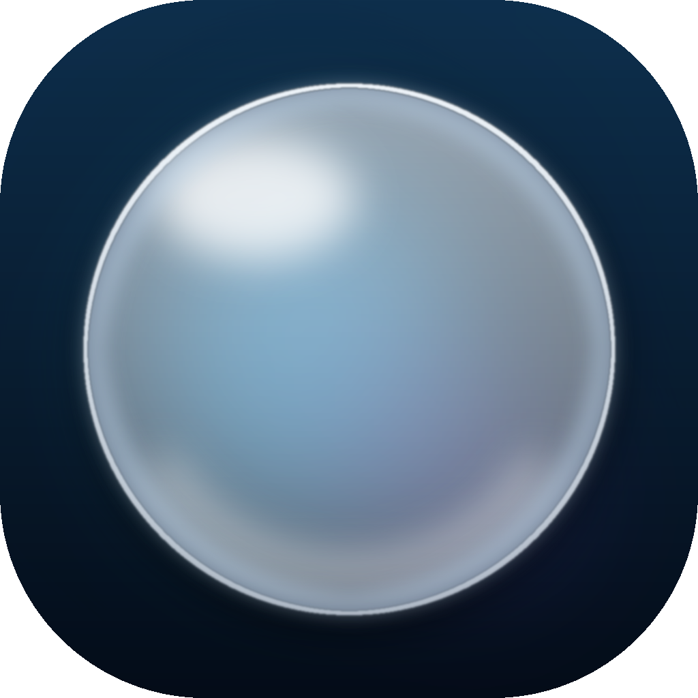
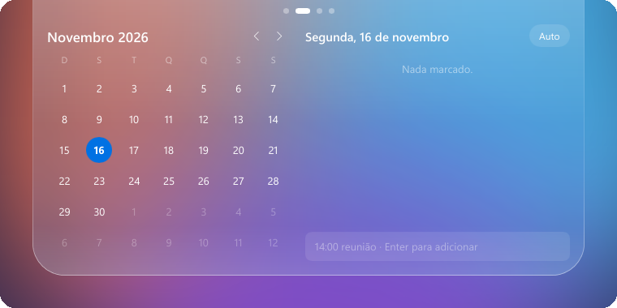
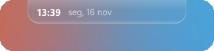
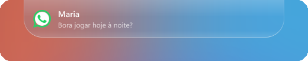
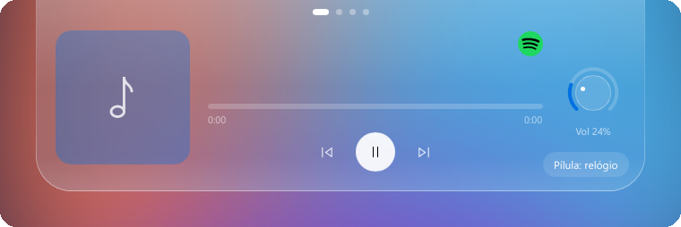
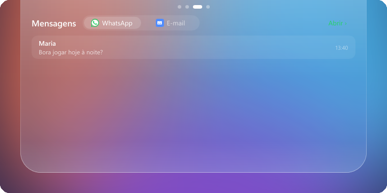
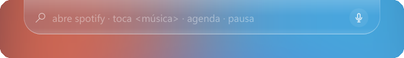
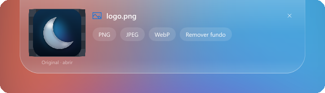
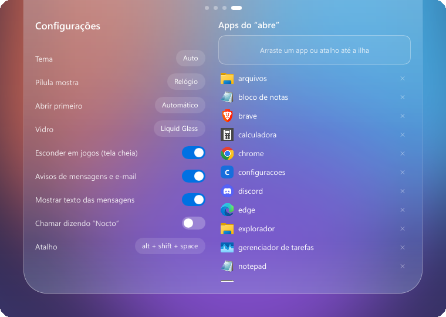

<p align="center">
  
</p>

<h1 align="center">Nocto</h1>

<p align="center">
  <b>A Dynamic Island do Windows.</b><br>
  Uma ilha de vidro colada no topo da tela: música, agenda, mensagens, comandos por voz e conversão de imagens.<br>
  Leve o bastante para não aparecer nem no jogo.
</p>

<p align="center">
  <a href="https://github.com/ianeusantiago/nocto/releases/latest"></a>
  
  
  
  <a href="LICENSE"></a>
</p>

<p align="center">
  
</p>

---

## Por que o Nocto

- **Leve de verdade.** ~35 MB de RAM e **0,01% de CPU** com a ilha escondida. Em jogo de tela cheia ela some e nada roda. [Medições →](docs/PERF.md)
- **Liquid Glass.** O vidro é desenhado pelo compositor do próprio Windows: desfoque, brilho, borda de luz e o "quique" da Dynamic Island.
- **Muda com o dia.** Azul-céu de manhã, laranja no pôr do sol, azul-noite à noite.
- **Tudo local e grátis.** Voz offline, remoção de fundo offline, agenda num arquivo seu. Nada de conta, nada de assinatura.

## Conheça

<table>
  <tr>
    <td align="center" width="50%">
      <br>
      <b>Pílula</b><br><sub>Relógio ou a música tocando, com a ondinha do som.</sub>
    </td>
    <td align="center" width="50%">
      <br>
      <b>Avisos</b><br><sub>WhatsApp e e-mail expandem a ilha por 5 segundos.</sub>
    </td>
  </tr>
  <tr>
    <td align="center">
      <br>
      <b>Música</b><br><sub>Capa, tempo, controles e um knob de volume do Spotify.</sub>
    </td>
    <td align="center">
      <br>
      <b>Mensagens</b><br><sub>Abas WhatsApp | E-mail com as últimas que chegaram.</sub>
    </td>
  </tr>
  <tr>
    <td align="center">
      <br>
      <b>Barra de comando</b><br><sub><code>Alt + Shift + Espaço</code> de qualquer lugar. Digite ou fale.</sub>
    </td>
    <td align="center">
      <br>
      <b>Solte uma imagem</b><br><sub>Converta para PNG, JPEG, WebP ou remova o fundo.</sub>
    </td>
  </tr>
</table>

<p align="center">
  <br>
  <b>Configurações</b> — tema, vidro, o que abre primeiro, avisos, voz, atalho e os apps do <code>abre</code> (arraste um app até a ilha para adicionar).
</p>

## Instalar

1. Baixe o `nocto.exe` na [última versão](https://github.com/ianeusantiago/nocto/releases/latest).
2. Abra. A pílula aparece no topo da tela.
   - Se o Windows avisar "O Windows protegeu o computador": **Mais informações › Executar assim mesmo**.
3. Clique na pílula ou aperte `Alt + Shift + Espaço`.

Não instala nada nem pede permissão de administrador. Para remover, apague o exe e a pasta `%APPDATA%\Nocto`.

## O que dá para fazer

| | |
|---|---|
| 🎵 **Música** | Capa do álbum, tempo e controles de qualquer player (Spotify, YouTube no navegador…). Knob de volume do Spotify. |
| ⏱️ **Timer** | `timer 3 min`, `bota um timer de 25 minutos`, `timer 1h30` (ou por voz). A pílula conta o tempo com um anel; no fim, som e aviso. `cancela o timer` para. |
| 📋 **Área de transferência** | `Alt + Shift + V` ou `copiados`. Histórico do que você copia (texto, links, cores, código colorido, imagens, arquivos): clique para ver em tamanho grande, copiar de novo, fixar ou apagar. A pílula avisa "Copiado". |
| 🎤 **Karaokê** | Na página de música, toque no microfone: a letra aparece sincronizada (LRCLIB), linha por linha, na cor do momento do dia (ou a que você escolher em Configurações). |
| 🗓️ **Agenda** | Escolha o dia, digite `14:00 reunião` e Enter. Clique no item para concluir. |
| 💬 **Mensagens** | WhatsApp e e-mail (Outlook, ou Gmail pelo navegador) pelas notificações do Windows. Clique para abrir. |
| ⌨️ **Comandos** | `abre brave` · `abre github.com` · `abre C:\Projetos` · `toca <música>` · `toca playlist <nome>` · `toca álbum <nome> by <artista>` · `coloca na fila <música>` · `pausa` · `próxima` · `agenda` |
| 🎙️ **Voz** | Clique no microfone e fale o comando. Opcional: diga **"Nocto"** para chamar sem tocar em nada. 100% offline. |
| 🖼️ **Imagens** | Arraste uma imagem até a ilha: PNG, JPEG, WebP ou **remover fundo** (IA local). A miniatura abre o arquivo no Explorador. |
| 🎮 **Modo jogo** | Em tela cheia, a ilha some e para de animar. Com o navegador maximizado ela se esconde; encoste o mouse no topo para espiar. |
| 🎨 **Personalizar** | Vidro (Liquid Glass, bem transparente ou fosco), tema por horário, o que a pílula mostra, a página que abre primeiro, atalho. |

### Spotify: "toca X" (opcional, precisa de Premium)

Play/pause/próxima funcionam sem nada disso. Para tocar por nome, use **o seu próprio app do Spotify** (grátis, 5 minutos, e ninguém precisa te liberar):

1. Nas Configurações da ilha, clique em **Spotify › Usar o meu**: abre o painel do Spotify.
2. Crie um app. Em **Redirect URIs**, coloque `http://127.0.0.1:8898/callback` e marque **Web API**.
3. Copie o **Client ID** e digite na barra: `spotify id <Client ID>`.
4. Digite `conectar spotify` e autorize.

## Por dentro

```
nocto/
├── core/      lógica pura e testada (comandos, agenda, tema, Spotify, voz, imagens)
├── src/       janela e Windows: vidro, notificações, mídia, volume, microfone
├── ui/        interface em Slint (island.slint)
└── docs/      medições de desempenho e roadmap
```

- **Rust + [Slint](https://slint.dev)** com renderizador por software: não disputa a GPU com o jogo.
- **Windows.UI.Composition** para o vidro e as animações, numa janela própria atrás da interface.
- **[Vosk](https://alphacephei.com/vosk/)** para voz offline e **U²-Net** (via [tract](https://github.com/sonos/tract)) para remover fundo; os modelos são baixados só quando você usa.

```bash
cargo build --release
cargo test -p nocto-core
```

## Limitações

- Jogos em **tela cheia exclusiva** não deixam nenhuma janela aparecer por cima; em tela cheia sem borda funciona.
- Sem os "Efeitos de transparência" do Windows, a ilha usa cor sólida no lugar do vidro.
- A voz offline entende bem comandos em português; nomes de música em inglês saem melhor digitados.

## Licença

[MIT](LICENSE): use, modifique e distribua à vontade, mantendo o aviso de copyright.

<p align="center"><sub>Feito com 🌙 em Rust.</sub></p>
